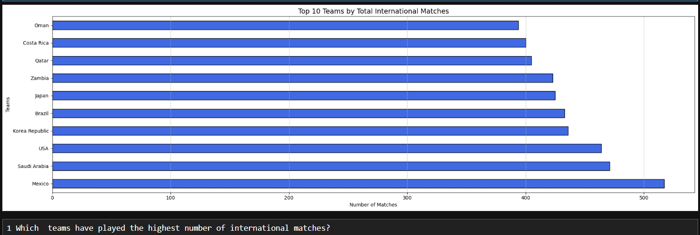
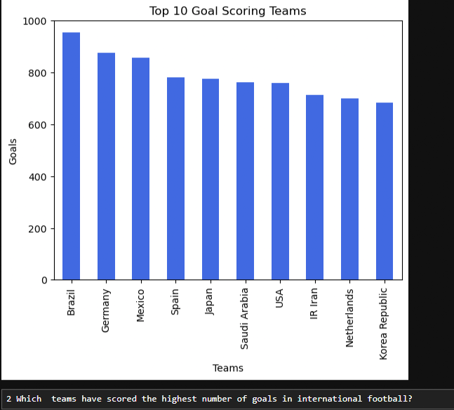
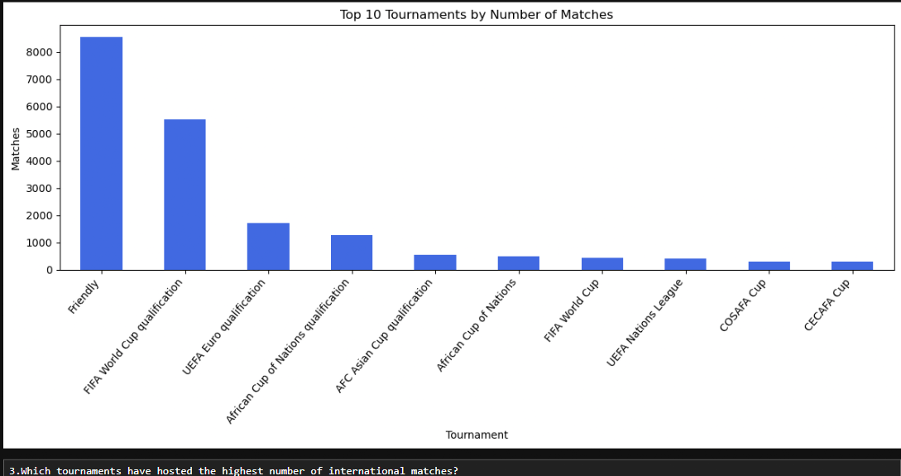
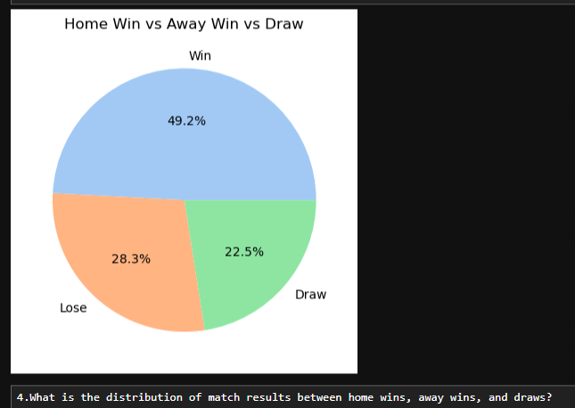
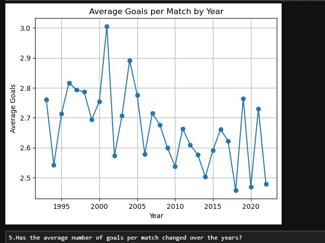
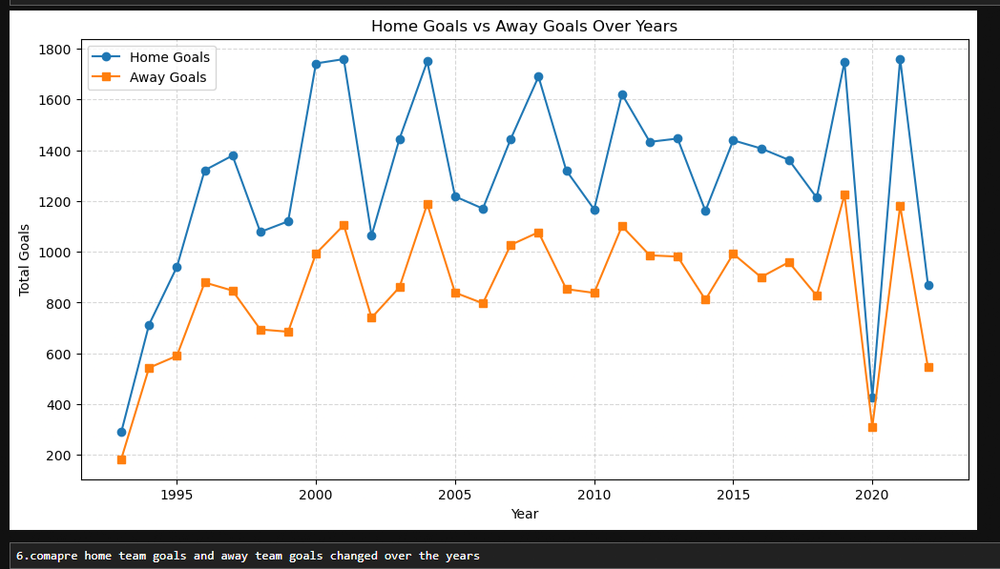
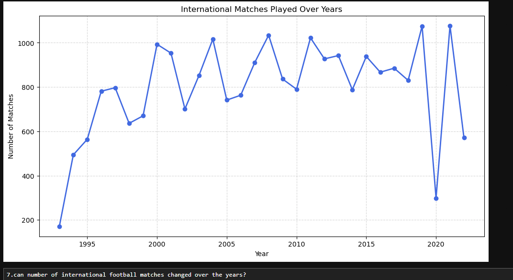
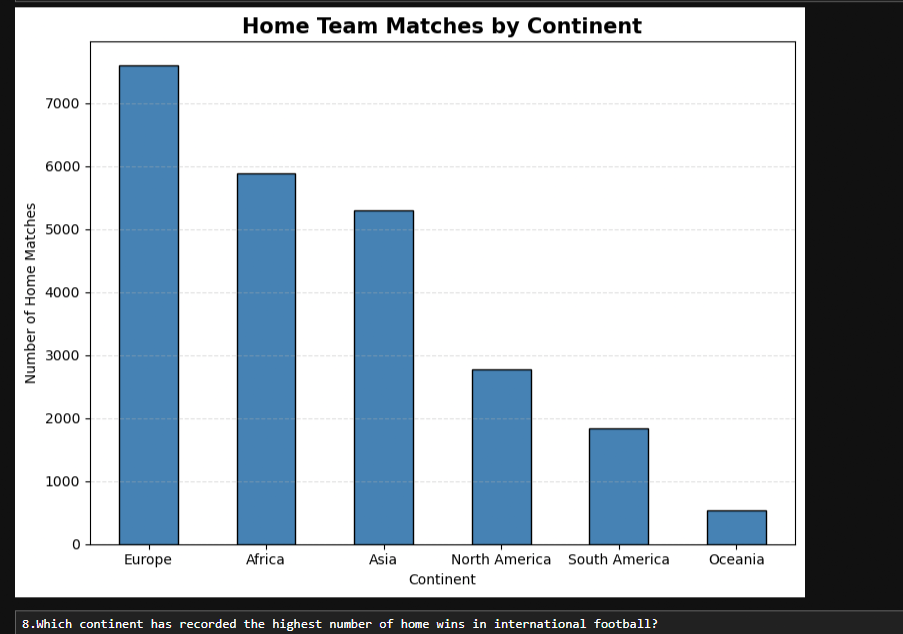
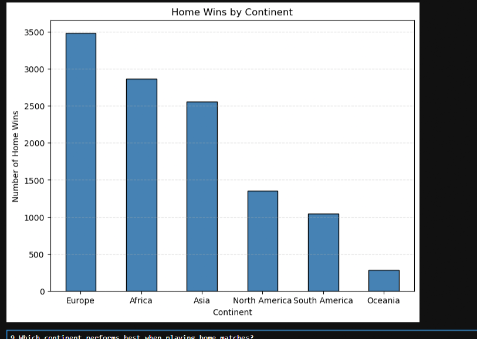

FIFA International Football Match Analysis ⚽

Project Overview

This project explores international football match data using Python. It analyzes team participation, goal scoring, tournament distribution, match outcomes, and home-versus-away performance through data analysis and visualization.

The goal is to transform raw football match data into meaningful insights using Python libraries.

Dataset

- Dataset: International Football Matches
- Records: 23,921 matches
- Columns: 25
- Period covered: 1993–2022

The dataset includes teams, FIFA rankings and points, match scores, tournaments, locations, match results, and team performance metrics.

Tools & Technologies

- Python
- Pandas — data cleaning and analysis
- Matplotlib — data visualization
- Jupyter Notebook — development environment

Project Workflow

1. Loaded and explored the dataset.
2. Checked data quality and prepared the date column.
3. Extracted the year to analyze changes over time.
4. Compared team match counts and goal totals.
5. Analyzed tournament frequency and match outcomes.
6. Visualized yearly scoring trends and home-team performance.

Key Analysis Questions

- Which national teams played the most matches?
- Which teams scored the most goals?
- Which tournaments had the highest number of matches?
- How were match outcomes distributed between home wins, away wins, and draws?
- How did international match activity and goal scoring change over time?
- How did home-team wins vary across continents?

Visualizations

# International Football Analysis (Python)

## Project Goal
Analyse international football results (1993–2022) to answer 9 questions about teams, goals, tournaments and home advantage.

**Tools:** Python, Pandas, Matplotlib

## Key Insights

### 1. Which teams have played the most international matches?

Mexico leads with over 500 matches, followed by Saudi Arabia and USA.

### 2. Which teams have scored the most goals?

Brazil is the top scorer, followed by Germany and Mexico.

### 3. Which tournaments have the most matches?

Friendlies dominate (8,000+), then World Cup qualifiers.

### 4. Home win vs away win vs draw

Home teams win 49.2% of matches, lose 28.3%, and draw 22.5%.

### 5. Average goals per match over the years

Peaked around 3.0 in 2001, then trended down to about 2.5.

### 6. Home goals vs away goals over the years

Home teams scored more than away teams in every year.

### 7. Matches played over the years

Matches grew strongly from the 1990s, with a sharp drop in 2020.

### 8. Which continent has the highest number of home wins?

Europe has the most home wins, followed by Africa and Asia.

### 9. Which continent performs best at home?

Europe also plays the most home matches, so raw win counts favour it. Win rate (home wins ÷ home matches) is the fair measure.

Skills Demonstrated

- Data exploration and preparation
- Date-time handling
- Aggregation and frequency analysis
- Sorting and ranking
- Grouping data with Pandas
- Data visualization and communicating insights

How to Run the Project

1. Clone or download this repository.

2. Install the required libraries:
   
   pip install pandas matplotlib jupyter

3. Open the notebook in Jupyter Notebook or JupyterLab.

4. Ensure the dataset is in the expected location.

5. Run the notebook cells in order.

Conclusion

This project demonstrates how Python can be used to explore historical international football data, identify patterns, and communicate findings through visualizations.

---

Author: Elaventhan E
Project Type: Data Analysis & Visualization
Tools: Python | Pandas | Matplotlib | Jupyter Notebook
